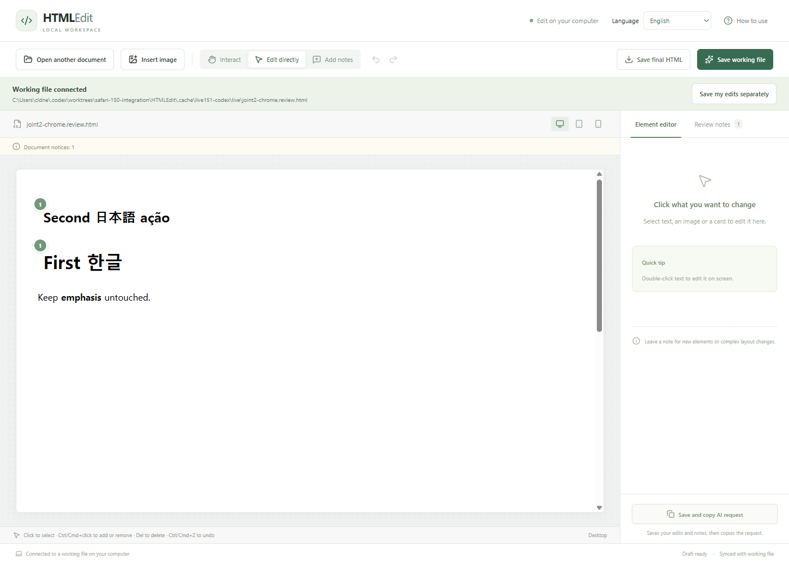
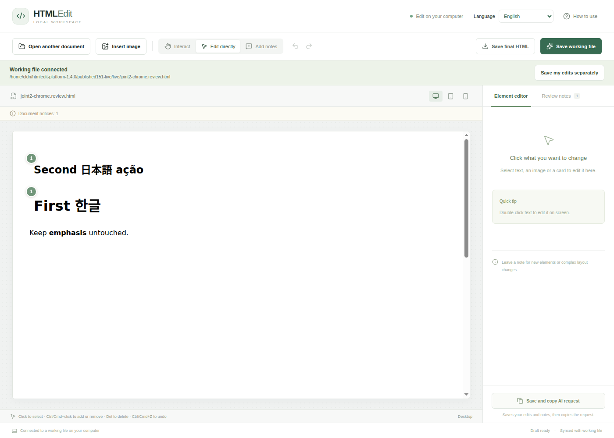

# Published 1.5.1 live skill verification

Date: 2026-10-15 (Asia/Seoul). Both flows passed against the public npm package, independently of the pre-publication candidate tests.

## Package and installation

- Package: @woody_s/htmledit@1.5.1; source commit c4fef7f5739bfa834bd072be0226d2118d93afa3.
- Published tarball SHA-256: 67fa19e01d2a2c12c34a742a597132b10ba9588f27b160458531489cfee88749 (npm/GitHub equality and provenance were checked during publication).
- Installed runtime/cli.mjs SHA-256 on Windows and WSL: fabfc0b44eed7d76d2196f70430b3677c1e990c286e24d4ad8a91e53832f8d36.
- Windows Claude and Codex skills initially still pointed to 1.4.0. After the user clarified installation had not been performed, the public 1.5.1 installer updated both. Both installed runners now point to the version-pinned 1.5.1 runtime.
- WSL used a fresh npm installation and isolated user/configuration directories under the HTMLEdit test directory. No development build was substituted.

## Actual AI and browser evidence

| Flow   | Environment                                                      | AI interpretation                                                                                                                                                                        | Result |
| ------ | ---------------------------------------------------------------- | ---------------------------------------------------------------------------------------------------------------------------------------------------------------------------------------- | ------ |
| Codex  | Windows, Chrome 155.0.8059.79, Node 22.17.0                      | This interactive Codex conversation read the saved joint note, checked out a candidate, edited it and applied the captured revision through the installed Windows skill                  | Passed |
| Claude | Ubuntu 24.04 WSL2/WSLg, Linux Chrome 155.0.8059.79, Node 22.23.3 | Authenticated native Claude Code 2.1.296 read its installed skill and joint-note reference, then performed status / checkout / candidate editing / apply / status; no permission denials | Passed |

Browser actions used headful Chrome automation. AI interpretation was real in both flows, not a deterministic CLI smoke standing in for an AI. The browser observer independently checked the saved files and rendered results after each AI finished.

## Completed scenario

1. Open a fresh static HTML fixture with the installed skill. Two headings contain Korean, Japanese and Portuguese text; an unrelated paragraph has a nested strong element. Preserve the original document language and script.
2. Ctrl+click two headings, toggle one selection off/on, delete both, undo, redo and undo.
3. Add ONE joint note requesting that the complete heading elements exchange positions while their IDs and text remain unchanged. Both targets display the same note number. Verify review version 2 and two ordered targets.
4. Switch ko / en / es / ja / pt-BR while composing; selection and pending note text survive.
5. Save and copy AI request. Verify the file is saved, the clipboard references the exact review path and includes joint-target instructions.
6. Delete the targets with their note present, undo, save and reopen. The note metadata and both targets remain intact.
7. Each AI reads the actual saved request, changes only its checked-out candidate and applies using the checkout revision. Only the fulfilled note becomes done. The full ordered targets list, note text, IDs, relations and summaries are preserved.
8. Observe the already-open editor update to Second / First without navigation or reload after apply. Both completed note markers remain attached. Each flow ends with one completed note and no pending notes.
9. Confirm unchanged source bytes, a byte-identical pre-apply backup, preserved nested markup and document language, and blocked user-script execution in the editing preview.
10. Download final HTML through the browser and verify the reordered headings and absence of review metadata and data-htmledit identifiers.

## Evidence

[SHA-256 checksums](verification/1.5.1/SHA256SUMS) cover the captured HTML, receipts and screenshots. HTML artifacts are excluded from formatting and Git newline conversion to preserve their recorded bytes.

- [Codex receipt](verification/1.5.1/codex-result.json), [before](verification/1.5.1/codex-before.review.html), [after](verification/1.5.1/codex-after.review.html), [final HTML](verification/1.5.1/codex.edited.html).
- [Claude receipt](verification/1.5.1/claude-result.json), [before](verification/1.5.1/claude-before.review.html), [after](verification/1.5.1/claude-after.review.html), [final HTML](verification/1.5.1/claude.edited.html).
- The two screenshots were visually inspected: the second heading is above the first, both note markers are green and share number 1, and the unrelated paragraph is unchanged.

## Test correction and limits

The first automation attempt in each environment sent Undo immediately after a deletion rebuilt the iframe. The key arrived before the new preview event listeners were ready. The harness was corrected to wait for iframe completion and two animation frames, and both full flows passed on fresh fixtures. Product source code was not changed. This is a harness timing correction, not evidence that arbitrarily rapid keyboard input is supported.

This follow-up checks Windows Chrome/Codex and WSLg Chrome/native Claude. It does not rerun Mac/Safari, Edge, physical file-picker interaction, Korean IME composition or image editing; their earlier evidence remains separate. Opening here uses the skill CLI, while browser selection, note creation, clipboard, refresh and download are exercised in the UI. The Windows Claude skill installation was verified, but actual Claude execution used the authenticated WSL CLI.

Existing user documents and existing editor sessions were not replaced. Only dedicated test fixtures were edited. No new package was published during this verification.
