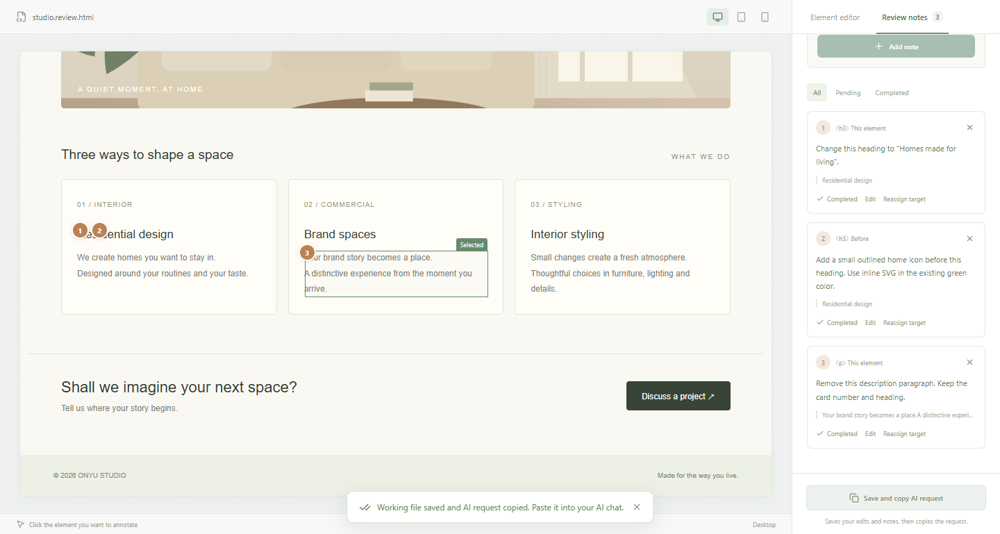
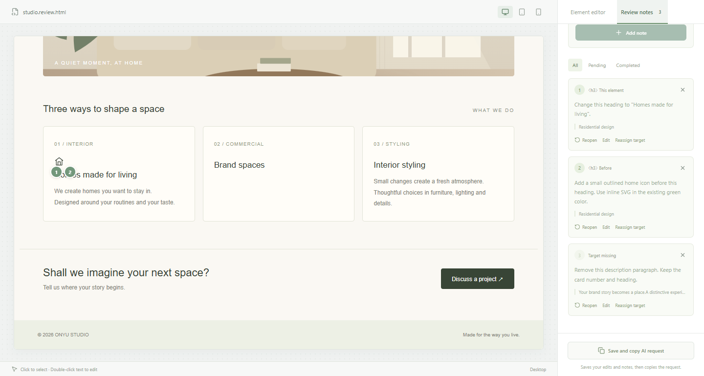

# HTMLEdit 사용 안내

[English](../../README.md) · [한국어](README.ko.md) · [Español](README.es.md) · [日本語](README.ja.md) · [Português (Brasil)](README.pt-BR.md)

**바꾸고 싶은 곳을 클릭하세요. HTML 수정은 AI에게 맡기세요.**

AI가 만든 HTML을 열고, 간단한 문구는 직접 고치고, 복잡한 변경은 해당 요소에 메모로 남깁니다. 저장한 요청을 Claude Code나 Codex에 전달하면 같은 편집기에서 결과를 확인할 수 있습니다.

“두 번째 카드 아래쪽 문단”처럼 위치를 설명하는 일이 번거로워서 만들었습니다.

**로컬 실행 · Claude Code·Codex 스킬 · 5개 언어 UI · MIT 오픈소스**

## 실제 사용 장면

편집기에서 제목 변경, 제목 앞 집 아이콘 추가, 다른 카드의 설명 삭제를 요청했습니다.



이 Codex 세션이 저장된 메모를 읽고 설치된 스킬의 절차로 반영한 결과입니다.



공개된 **1.3.0 패키지와 Windows Chrome**으로 검증했습니다. 브라우저 조작은 자동화했고, 메모 해석과 후보 파일 수정은 현재 Codex 세션이 수행했습니다. 화면 자동 갱신, 백업, 다시 열기, 메모 없는 HTML 저장까지 확인했습니다. Claude Code Remote Control도 1.3.0 후보에서 수동 승인 후 다섯 언어의 메모를 반영한 별도 기록이 있습니다. [전후 HTML과 검증 범위](../AI_WORKFLOW_VERIFICATION.md)를 확인할 수 있습니다.

## 이렇게 사용하세요

1. HTML을 열면 원본 옆에 작업 사본이 만들어집니다.
2. 문구·색상·이미지를 직접 바꾸거나 요소를 선택해 메모를 남깁니다.
3. **저장하고 AI 요청 복사**를 누르고 AI 대화에 붙여 넣습니다.
4. AI가 반영한 결과와 완료된 메모를 확인합니다.
5. **완성본 저장**으로 메모 없는 HTML을 받습니다.

HTMLEdit에는 별도 계정이나 API 키가 필요하지 않습니다. AI 도구는 해당 서비스의 계정과 요금 정책을 사용합니다. 1.4.0에는 이미지 삽입 기능이 추가되었습니다. 기본 지원 환경은 Windows Chrome·Edge입니다. Linux·macOS 실행과 파일 선택 기능은 실험적으로 제공하며, Ubuntu 24.04 WSL2 및 macOS 15.6.1 Apple Silicon의 Chrome 자동 검사는 통과했습니다. Safari와 기본 파일 선택창의 수동 검증은 아직 완료하지 않았습니다.

## 설치와 열기

Node.js 22.12 이상과 PC에서 실행하는 Claude Code 또는 Codex가 필요합니다. HTMLEdit 소스 저장소 밖의 폴더에서 실행하세요.

```sh
npx --yes @woody_s/htmledit@latest install --agent all
npx --yes @woody_s/htmledit@latest open "./document.html"
```

한 도구만 설치하려면 `--agent claude` 또는 `--agent codex`를 사용합니다. Claude에서는 `/htmledit`, Codex에서는 `$htmledit`를 선택하거나 HTML을 HTMLEdit로 열어 달라고 요청하세요. 스킬이 보이지 않으면 새 AI 세션을 엽니다. 원본 옆의 `document.review.html`이 작업 파일이며 원본은 보존합니다. 기존 작업 파일이 있다면 해당 파일을 다시 여세요.

## 언어

상단 **언어** 메뉴에서 한국어·영어·스페인어·일본어·브라질 포르투갈어를 선택합니다. 기본 **자동 감지**는 브라우저 선호 언어를 따르며 미지원 언어는 영어로 표시합니다. `es-MX`는 스페인어, `pt-PT`는 브라질 포르투갈어로 연결합니다.

수동 선택은 연결 모드에서 문서·포트가 바뀌어도 유지되고, 다운로드 모드에서는 현재 브라우저 주소별로 저장됩니다. 언어 변경은 선택 요소·작성 중 입력·실행 취소·미저장 작업을 보존합니다. 사용자 HTML, 문서의 `lang`, 파일명과 메모 내용은 번역하지 않습니다. 예제는 여는 시점의 언어로 표시합니다.

CLI는 `--lang` → 저장된 수동 선택 → 운영체제 언어 → 영어 순입니다. `open --lang`은 이번에 여는 화면의 초기 언어만 지정하며 기본 설정을 바꾸지 않습니다.

```sh
npx --yes @woody_s/htmledit@latest open "./document.html" --lang ja
npx --yes @woody_s/htmledit@latest --help --lang ko
```

지원 값은 `ko`, `en`, `es`, `ja`, `pt-BR`이며 대응하는 지역 코드도 인식합니다. 명령·JSON 키·오류 코드·ID는 바뀌지 않습니다. 설정은 `~/.htmledit/preferences.json` 또는 `HTMLEDIT_HOME` 아래에 저장합니다. 설정 저장 실패 시 편집 내용은 유지되며 언어 선택이 다음 실행에 유지되지 않을 수 있습니다.

## 편집과 AI 반영

1. 요소를 클릭해 문구·색상·크기를 변경합니다. 문구 더블클릭으로 제자리 편집하며 Ctrl+Enter로 적용, Esc로 취소합니다. 조합 입력과 중첩 강조·링크를 유지합니다.
2. 카드 전체는 **상위 요소 선택**으로 지정합니다. 요소 삭제와 PNG·JPEG·WebP·GIF 이미지 교체를 지원합니다. 반응형 이미지도 새 이미지가 표시되며 HTML에 포함해 저장합니다.
3. **메모 남기기**에서 대상을 고르고 **이 요소·앞·뒤·안쪽**과 요청을 입력합니다. 요소 추가나 배치 변경은 메모로 요청하세요. 번호 표식과 목록이 연결됩니다.
4. 입력한 문구와 메모를 먼저 적용한 다음 **저장하고 AI 요청 복사**를 누릅니다. 연결 모드는 작업 파일 저장 후 경로가 포함된 요청을 복사합니다. **작업 파일 저장**은 저장만 합니다. 다운로드 모드는 내려받은 review HTML도 요청과 함께 첨부합니다.
5. AI 대화에 요청을 붙여넣습니다. 스킬은 `status → checkout → 후보 수정 → apply → status`를 수행합니다. apply는 리비전 검사·백업 후 작업 파일을 갱신합니다. 미저장 편집이 없으면 열린 화면에 자동 반영됩니다.
6. 결과와 완료 메모를 확인하고 **완성본 저장**으로 메모·식별자 없는 `document.edited.html`을 받습니다. 완성본에서는 이전 메모를 복원할 수 없습니다.

메모 수정·삭제·완료·다시 열기·대상 재지정을 지원합니다. 대상이 없거나 중복이면 추측해서 연결하지 않습니다. 삭제를 완료한 메모는 **대상 없음**으로 남을 수 있습니다. 앱은 요청의 이행 여부를 자동 판정하지 않습니다.

미적용 입력·저장 오류·충돌·저장 중 추가 변경이 있으면 요청 복사를 중단합니다. 저장만 성공하고 복사가 실패하면 사용 방법의 전달 문구를 직접 복사하세요.

## 문서 전환·조작·복구

**다른 문서 열기**는 미저장 작업의 저장 여부를 확인하고 운영체제 파일 선택 창을 엽니다. 취소·저장 실패 시 현재 문서를 유지하며 기존 review 파일은 덮어쓰지 않습니다. 이전 서버와 백업도 유지됩니다. 선택 창의 기본 버튼 언어는 운영체제 설정을 따릅니다.

신뢰하는 문서에서 **문서 조작**으로 메뉴·탭을 이동한 후 **직접 편집** 또는 **메모 남기기**로 전환하세요. **첫 화면으로**는 이동 상태만 초기화합니다. 원본 요소의 클래스·스타일·숨김 상태를 지원하며 스크립트 생성 요소·폼 값·캔버스 편집은 지원하지 않습니다. 메뉴·스크롤은 세션 표시 상태이고 파일에 저장하지 않습니다. 원본 스크립트는 내보내기에 유지합니다.

review HTML에는 보이지 않는 메모·ID·영어 AI 안내 주석이 있으며 일반 브라우저에는 문서만 보입니다. 손상된 메모·미지원 버전은 저장을 막습니다. 원본을 보관한 뒤 명시적으로 **읽을 수 없는 메모 제외**를 선택하세요. 브라우저 소스 보기로 저장한 HTML은 원래 문서를 복원하고 일반 코드 예제는 유지합니다.

연결 모드 임시 작업·후보·바이트 보존 백업은 문서 옆 `.htmledit/`에 있습니다. 파일 쓰기는 리비전을 검사합니다. 외부 변경과 내 미저장 편집이 겹치면 **내 작업 별도 저장** 후 **디스크 버전 다시 열기**를 사용하세요. 외부 프로그램은 쓰기 잠금에 참여하지 않으므로 AI는 반드시 직접 덮어쓰기 대신 `apply`를 사용해야 합니다.

다운로드 모드는 주소별 IndexedDB에 최근 작업 하나를 약 0.6초 뒤 임시 저장합니다. 장기 보관은 HTML 파일로 저장하세요. 실행 취소·다시 실행은 현재 세션의 최근 50번 변경을 지원합니다. 임시 복구·AI 결과 재열기는 과거 실행 취소 기록을 복구하지 않으며 이전 파일 버전은 백업으로 복원합니다.

## 업데이트·종료·제거

설치 명령을 다시 실행해 업데이트하고 새 편집기를 여세요. 실행 코드는 `~/.htmledit/versions/<version>`에 고정되어 npm 캐시 정리 후에도 유지됩니다. 사용자가 수정한 스킬은 보호하므로 오류에 표시된 폴더를 별도 보관한 뒤 재설치하세요.

Codex의 runner는 `~/.agents/skills/htmledit/scripts/run.mjs`, Claude는 `~/.claude/skills/htmledit/scripts/run.mjs`입니다.

```sh
node "<skill-directory>/scripts/run.mjs" status --file "./document.review.html" --json
node "<skill-directory>/scripts/run.mjs" stop --file "./document.review.html"
node "<skill-directory>/scripts/run.mjs" uninstall --agent all
```

서버를 먼저 종료하세요. 제거는 관리되는 스킬만 지우고 문서·백업·설정·실행 코드·실행 중 서버는 유지합니다. 독립 클라우드 AI는 PC 파일에 직접 접근하지 못합니다. 지원 범위는 실제 확인한 환경으로 한정하며 다른 Linux 배포판, Intel Mac, 다른 macOS 버전은 미검증입니다.

## 지원 범위와 데이터

CSS·이미지가 포함된 단일 UTF-8 정적 HTML을 사용하세요. HTML 최대 25MB, 교체 이미지 최대 10MB, 메모 최대 5,000개·각 1~20,000자입니다. 저장 시 HTML 표기는 정규화될 수 있습니다. 외부 이미지·CSS·폰트 URL은 유지하고 관련 로컬 폴더는 수집하지 않습니다. React 앱·동적 차트·실행형 Tailwind 의존 문서는 지원 범위 밖입니다. 데스크톱·768px·390px 너비로 반응형을 확인합니다.

편집·메모 모드는 스크립트를 차단합니다. 조작 모드는 분리된 sandbox 출처에서 인라인 스크립트를 실행하며 편집기 저장 공간과 연결 토큰은 노출하지 않습니다. 외부 스크립트·fetch/XHR·폼·팝업·상위 이동은 차단하지만, 문서 스크립트는 미리보기 내용을 읽고 이미지·스타일 요청 또는 자신의 프레임 이동으로 데이터를 보낼 수 있습니다. 신뢰하는 문서에서만 조작 모드를 사용하세요. 프레임 이동으로 연결이 끊기면 첫 화면으로 돌아가세요.

서버는 `127.0.0.1`에서 지정한 작업 파일을 다룹니다. 편집 권한 토큰이 포함된 연결 URL은 공유하지 마세요. HTMLEdit은 AI 호출·사용량 수집을 하지 않습니다. AI에게 처리를 요청하면 해당 서비스의 요금·데이터 정책이 적용됩니다.

## 개발과 참고

```sh
npm ci
npm run build
npm start
npm test
npm run test:e2e
npm run test:package
```

다운로드 모드는 `http://127.0.0.1:5173`을 사용합니다. Windows의 `start.cmd`도 설치·빌드·브라우저 열기를 수행하며 창 종료 또는 Ctrl+C로 서버를 멈춥니다. 개발은 `npm run dev`를 사용합니다. 브라우저 테스트에는 모든 환경에서 Chrome, Windows에서는 추가로 Edge가 필요합니다. 실제 Safari 검증은 별도로 기록합니다.

번역 예제: 소스의 `public/examples/<language>/`, 패키지의 `dist/examples/<language>/`. [메모 형식](REVIEW_FORMAT.ko.md), [용어집](GLOSSARY.md), [검증 기록](../SKILLS_VERIFICATION.md). MIT 라이선스입니다.

## 운영체제별 준비

Ubuntu 데스크톱과 WSLg에는 Chrome, zenity, xdg-utils가 필요합니다. `sudo apt-get install zenity xdg-utils`로 선택 도구를 설치하세요. WSL에서는 WSLg 세션과 Linux용 Node·Chrome을 사용합니다. Windows 브라우저 접속은 별도 연동 검증입니다. macOS는 기본 파일 선택 창을 사용하며 편집 단축키는 Ctrl 대신 Cmd를 사용합니다.

SSH·화면 없는 환경에서는 `open "./document.html" --no-browser --json`을 실행하세요. 반환된 URL은 서버 컴퓨터의 주소입니다. 원격에서 보려면 반환된 포트에 루프백 SSH 터널을 연결하고 서버를 외부에 공개하지 마세요. 파일 선택 창은 서버 컴퓨터의 데스크톱에 표시됩니다. 데스크톱이나 선택 도구가 없으면 CLI로 다른 문서를 여세요. URL의 인증 토큰은 공개 로그에 남기지 마세요.

[Verification / 검증 기록](../SKILLS_VERIFICATION.md)

## 이미지 삽입

문서 요소를 선택하고 **이미지 삽입**을 누릅니다. **앞 / 뒤 / 안쪽 마지막**을 선택하면 삽입 위치 표식과 문서 미리보기에서 결과를 확인할 수 있습니다. 표의 행이나 목록 루트에는 직접 넣지 않고 셀·목록 항목·적절한 상위 영역을 선택합니다.

로컬 PNG·JPEG·WebP·GIF 파일 한 개를 선택하거나 이미지 패널에 끌어놓으세요. 패널의 붙여넣기 영역에서는 Ctrl+V / Cmd+V로 이미지를 붙여넣을 수 있으며, 직접 이미지 HTTP/HTTPS URL도 지원합니다. 이미지당 최대 10MB이며 실제 이미지로 읽을 수 있어야 합니다. URL은 인증 정보 없이 가져오며 다운로드 제한 시간은 15초입니다. 사이트의 접근 제한으로 실패하면 내려받은 파일이나 붙여넣기를 사용하세요. SVG·HTML 클립보드 조각·여러 이미지 동시 삽입은 지원하지 않습니다.

원본 크기(영역 너비 이내) 또는 영역 대비 1–100% 너비, 왼쪽·가운데·오른쪽 정렬, 대체 텍스트를 지정합니다. **이미지 적용**을 눌러야 HTML 안에 이미지가 포함되고 실행 취소 한 단계가 생깁니다. 확정 전 미리보기는 저장 내용과 실행 취소 기록을 바꾸지 않습니다. 모든 이미지를 포함한 HTML 전체는 25MB 이하여야 하며 자동 압축·형식 변환은 하지 않습니다.

삽입 후 이미지가 선택됩니다. **이미지 크기·정렬**로 다시 조정하거나 AI에게 배치 수정을 요청하는 메모를 남기세요. **이미지 교체**도 파일·URL·붙여넣기를 지원하며 기존 배치 스타일을 유지합니다. 이미지 패널을 적용하거나 취소한 다음 저장하고 AI 요청을 복사하세요. 기존 checkout/apply 절차와 review 형식 v1은 그대로입니다.

## 다중 선택과 Del 삭제

클릭하면 요소 하나를 선택합니다. Ctrl+클릭(Mac은 Cmd+클릭)으로 선택을 추가하거나 해제합니다. 선택한 요소마다 테두리가 표시됩니다. **선택한 요소에 메모 하나 남기기**를 누르면 여러 대상을 묶은 요청 하나가 생성되고, 각 대상에 같은 메모 번호가 표시됩니다. 메모 목록에서 각 대상으로 이동하고 대상 없음 상태를 확인할 수 있습니다. 대상 재지정은 현재 선택한 요소 목록으로 대상을 교체합니다.

**Del**을 누르면 확인창 없이 선택한 요소를 삭제합니다. **Ctrl+Z / Cmd+Z** 한 번으로 전체 삭제를 복원합니다. 삭제된 대상의 메모는 유지합니다. 문구·메모 입력, 제자리 문구 편집, 대화상자와 문서 조작 모드에서는 이 단축키로 문서 요소를 삭제하지 않습니다. 문서 본문 전체는 삭제할 수 없습니다.

여러 요소를 선택한 직접 편집에서는 일괄 삭제를 제공합니다. 문구·색상·크기·이미지 편집은 요소 하나를 선택하세요. 스타일 일괄 적용은 이번 범위에 포함하지 않습니다. 단일 대상 메모는 기존 review v1, 묶음 메모가 포함된 파일은 v2를 사용합니다. 묶음 메모 사용 전 편집기와 AI 실행 도구를 업데이트하세요. 구버전은 대상을 잃지 않도록 v2 파일을 지원하지 않는 형식으로 처리합니다.
